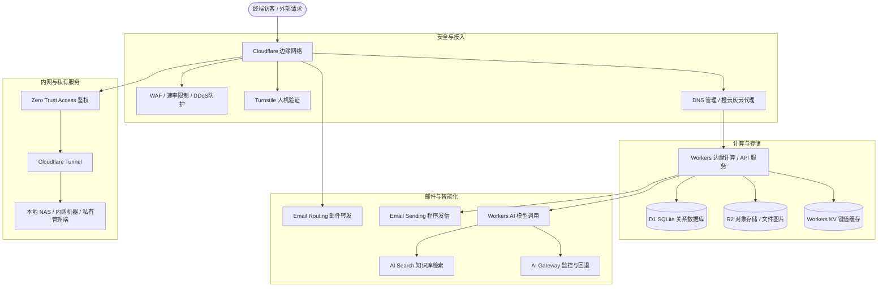
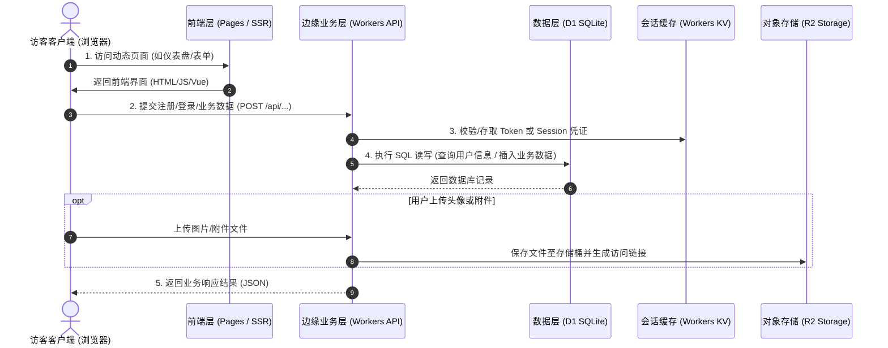
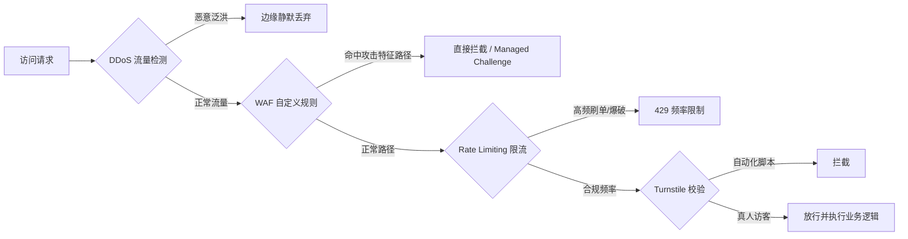

# Cloudflare 全生态从 0 到 1 实操速查指南

本指南系统化梳理了 Cloudflare 面向个人网站与轻量项目的一站式基础设施能力，按照“网络接入 → 计算存储 → 安全加速 → AI 增强 → 运维隔离”的技术链路，提炼各模块的核心场景、操作路径、关键避坑要点与 AI 协作方案。

---

## 目录
- [一、全局能力拓扑与选型全景](#一全局能力拓扑与选型全景)
- [二、DNS 配置与代理机制](#二dns-配置与代理机制)
- [三、域名邮箱与服务发信](#三域名邮箱与服务发信)
- [四、边缘计算与动态全栈网站部署（免服务器方案）](#四边缘计算与动态全栈网站部署免服务器方案)
- [五、存储三大件选型矩阵（R2 / D1 / KV）](#五存储三大件选型矩阵r2--d1--kv)
- [六、HTTPS、CDN 缓存与路径重定向](#六httpscdn-缓存与路径重定向)
- [七、多层安全防护与防刷风控体系](#七多层安全防护与防刷风控体系)
- [八、自动化定时任务（Cron Triggers）](#八自动化定时任务cron-triggers)
- [九、边缘 AI 体系（Workers AI / Gateway / Search）](#九边缘-ai-体系workers-ai--gateway--search)
- [十、可观测性与告警监控](#十可观测性与告警监控)
- [十一、内网穿透与零信任访问控制（Tunnel + Access）](#十一内网穿透与零信任访问控制tunnel--access)
- [十二、需求对号入座表与 AI 协作提示词](#十二需求对号入座表与-ai-协作提示词)

---

## 一、全局能力拓扑与选型全景



---

## 二、DNS 配置与代理机制

### 1. 核心记录类型
* **A / AAAA**：直接解析到 IPv4 / IPv6 地址。
* **CNAME**：别名解析，映射到另一个域名（如 Vercel、GitHub Pages 等托管服务）。
* **MX**：邮件交换记录，声明由哪个邮件系统处理来信。
* **TXT**：文本记录，用于域名所有权校验、SPF/DKIM 邮件防伪签名等。

### 2. 橙云（Proxied）vs 灰云（DNS Only）
* **橙云（开启代理）**：
  * **机制**：流量先经过 Cloudflare 边缘节点，再回源到实际服务器。
  * **收益**：隐藏真实源站 IP、提供 DDoS 防护、开启 CDN 边缘缓存与 WAF 拦截规则。
  * **场景**：个人网站、博客、公开 Web 应用前端。
* **灰云（仅做解析）**：
  * **机制**：客户端直接解析得到源站 IP，绕过 Cloudflare 节点。
  * **场景**：第三方服务强制要求直连（如部分邮件托管服务、特定的 SSL 申请验证等）。
  * > [!IMPORTANT]
    > MX 与 TXT 记录不存在云朵代理开关；严禁无脑全开橙云，避免干扰邮件服务及直连 API。

---

## 三、域名邮箱与服务发信

### 1. 收信转发（Email Routing）
* **定位**：轻量级域名邮件接收方案（仅提供转发能力，无独立收件箱）。
* **入口**：`Compute → Email Service → Email Routing`
* **流程**：
  1. 在 `Destination addresses` 中添加并激活最终接收的真实邮箱（如 Gmail）。
  2. 点击 `Onboard Domain` 自动补齐 DNS 记录（MX 与 TXT）。
  3. 在 `Routing rules` 创建自定义转发规则（如 `hello@yourdomain.com` → 绑定的 Gmail）。
* **注意**：在接收邮箱直接点击“回复”时，发件人仍为个人主邮箱；若需显示为域名地址回复，需额外配置发信身份。

### 2. 主动发信（Email Sending / Workers Paid）
* **定位**：用于网站发送系统验证码、注册通知、密码找回等场景的程序化发信通道。
* **配额与计费**：开通 Workers Paid 方案（$5/月起），每月赠送 3000 封额度。
* **接入方式**：
  * **SMTP 协议**：在后台填写 Host、Port、Username 与发信密钥（Password）。
  * **REST API / Worker Binding**：通过代码调用官方 API 或边缘 Worker 直接绑定调用。

---

## 四、边缘计算与动态全栈网站部署（免服务器方案）

### 1. 传统云服务器 vs Cloudflare Serverless 全栈对比
| 对比维度 | 传统云服务器方案（ECS / CVM / VPS） | Cloudflare 全栈 Serverless 方案 |
| :--- | :--- | :--- |
| **服务器成本** | 需常年付费租用云主机，未访问也计费 | **零硬件持有成本**，免费额度极高，无流量不计费 |
| **系统运维** | 需维护 Linux、Nginx、配置防火墙、打系统补丁 | **零系统运维**，底层基础设施、高可用由平台全托管 |
| **弹性伸缩** | 流量突增需扩容 CPU/内存或增加负载均衡实例 | **全球边缘秒级自动弹性伸缩**，无冷启动感知 |
| **多地域加速** | 需单独采购并配置 CDN 节点、跨区同步 | 业务代码与数据库直接运行在最靠近访客的边缘节点 |

### 2. 动态网站核心架构与数据流转
借助 Cloudflare，一个具备**用户注册、登录鉴权、数据库读写、文件上传、页面渲染**的完整动态网站可以这样组合：



### 3. 主流动态全栈实现模式
1. **前后端分离模式（轻量首选）**：
   * **前端**：Vue / React / Vite 构建产物直接托管在 **Cloudflare Pages**。
   * **后端**：用 **Cloudflare Workers** 编写 RESTful API 接口，绑定 D1（数据持久化）和 KV（用户鉴权）。
2. **现代全栈框架 SSR 模式**：
   * 支持 Next.js（通过 `@opennextjs/cloudflare`）、Nuxt.js、Astro、Remix、SvelteKit 等。
   * 服务端渲染逻辑直接编译运行在 Workers 边缘节点上，兼顾 SEO 和首屏动态数据直出。

### 4. 最佳实践推荐：Vue 3 + Vite (前端) + Bun + Hono (后端)

针对同时追求“本地极速开发”与“线上零服务器成本”的项目，**Vue 3 (Vite) + Bun (Hono)** 是当前最优雅的前后端分离组合。

#### (1) 工程目录规范
```text
my-project/
├── functions/              # ⬅️ 【后端 API 层】基于 Hono（天然支持 Bun 本地运行与 CF Workers 边缘部署）
│   ├── [[route]].js        # Hono 全局路由分发入口
│   └── api/
│       ├── auth.js         # 用户鉴权 / 登录接口
│       └── data.js         # 业务增删改查接口
├── src/                    # ⬅️ 【前端 视图层】Vue 3 + Vite 标准工程
│   ├── views/
│   ├── components/
│   └── main.js
├── index.html
├── package.json
└── vite.config.js
```

#### (2) 后端代码实现：Hono + Cloudflare D1 数据库
Hono 采用 Web 标准 Request/Response 构建，一套代码在**本地由 Bun 秒级启动**，在**线上由 Cloudflare Workers 直接执行**：
```typescript
import { Hono } from 'hono'

// 声明绑定资源类型（D1 数据库与 KV 缓存）
type Bindings = {
  DB: D1Database
  KV: KVNamespace
}

const app = new Hono<{ Bindings: Bindings }>().basePath('/api')

// 1. 获取列表接口
app.get('/users', async (c) => {
  const { results } = await c.env.DB.prepare(
    'SELECT id, username, email FROM users ORDER BY id DESC LIMIT 20'
  ).all()
  return c.json({ code: 200, data: results })
})

// 2. 提交数据接口（参数化防注入）
app.post('/register', async (c) => {
  const { username, email } = await c.req.json()
  
  await c.env.DB.prepare(
    "INSERT INTO users (username, email, created_at) VALUES (?, ?, datetime('now'))"
  ).bind(username, email).run()

  // 写入会话缓存
  await c.env.KV.put(`user:${email}`, username, { expirationTtl: 3600 })

  return c.json({ code: 200, message: '注册成功' })
})

export default app
```

#### (3) 前端调用实现：Vue 3 (Vite)
前端无需关心服务端在何处运行，使用相对路径调用接口，天然同源无跨域：
```vue
<script setup>
import { ref, onMounted } from 'vue'

const userList = ref([])
const isSubmitting = ref(false)

const loadUsers = async () => {
  const res = await fetch('/api/users')
  const json = await res.json()
  if (json.code === 200) userList.value = json.data
}

const handleRegister = async (form) => {
  isSubmitting.value = true
  try {
    const res = await fetch('/api/register', {
      method: 'POST',
      headers: { 'Content-Type': 'application/json' },
      body: JSON.stringify(form)
    })
    const json = await res.json()
    if (json.code === 200) await loadUsers()
  } finally {
    isSubmitting.value = false
  }
}

onMounted(loadUsers)
</script>
```

#### (4) 开发与发布流水线
* **本地开发**：
  * 后端直接用 `bun run --hot`，秒级热重载。
  * 前端通过 Vite `vite` 启动，Vite 配置 `proxy` 指向本地 Bun 端口；或者使用 `npx wrangler pages dev dist` 一键联调全套 Cloudflare 边缘模拟环境。
* **线上部署**：
  * 推送代码至 GitHub/GitLab，Cloudflare Pages 自动运行 `vite build` 生成静态前端，同时自动打包 `functions/` 成为全球边缘 API。

> [!CAUTION]
> 接口签名密钥（JWT Secret）、第三方 API Key 等敏感凭据必须统一配置在 Cloudflare 后台的 **Variables and Secrets** 中，严禁在前端代码或公开 Git 仓库中泄露。

### 5. 适用边界：何时用 Cloudflare 全家桶？何时仍需传统服务器？
* **完美适用（首选 Cloudflare）**：
  * 个人博客、内容社区、企业官网后台。
  * 问卷报名系统、轻量 CRM、SaaS 应用的 Web 管理台。
  * 包含身份验证、数据增删改查（CRUD）、文件上传分发的标准 Web 应用。
* **边界场景（建议使用传统独立服务器）**：
  * **超长耗时后台运算**：Worker 单次请求有 CPU 执行时限，不适合用于视频转码、深度学习模型本地训练等重型任务。
  * **特定常驻进程服务**：需要运行复杂 Docker 编排、常驻内存的重型游戏服务端、私有底层协议守护进程。

---

## 五、存储三大件选型矩阵（R2 / D1 / KV）

| 维度 | R2 (Object Storage) | D1 (SQLite Database) | Workers KV (Key-Value) |
| :--- | :--- | :--- | :--- |
| **存储类型** | 大文件/静态对象存储 | 关系型关系数据库 (SQLite) | 键值对存储 |
| **典型场景** | 图片、视频、PDF、安装包附件 | 报名名单、用户信息、订单流水 | 站点公告、全局开关、只读轻量字典 |
| **一致性模型** | 强一致性 | 强一致性 (ACID 事务) | 最终一致性（边缘同步存在数秒延迟） |
| **公开访问** | 支持绑定自定义域名公开访问 | 仅供 Worker 后端 API 读取 | 仅供 Worker 后端 API 读取 |
| **关键特性** | 免出口流量费（Zero Egress Fees） | 支持 SQL 查询、自带 Time Travel 回滚 | 高并发边缘读取优化，极低延迟 |
| **典型禁忌** | 严禁与私密附件共用公开桶 | 不宜承载海量高频日志流 | **绝对不要存**账户余额、库存等高并发强一致数据 |

---

## 六、HTTPS、CDN 缓存与路径重定向

### 1. SSL/TLS 加密模式
* **Flexible**：浏览器到 Cloudflare 加密，Cloudflare 到源站走明文 HTTP（若源站强跳 HTTPS 会引起无限重定向死循环）。
* **Full / Full (Strict)**（推荐）：端到端全程加密，Strict 模式强制源站使用有效 CA 证书。

### 2. 缓存管理与清除
* 静态资源（JS/CSS/图片）自动缓存到全球边缘。
* **清除缓存路径**：`Caching → Configuration → Custom Purge`，输入具体 URL 即可定点失效旧资源。
* > [!WARNING]
  > 用户身份中心、订单明细等涉及个性化动态数据的页面，严禁配置静态缓存规则。

### 3. URL 路由重定向（Redirect Rules）
在 `Rules → Redirect Rules` 中配置匹配规则（如 `/old-path` → `/new-path`），支持 301（永久）与 302（临时）跳转，避免死链流失访客。

---

## 七、多层安全防护与防刷风控体系



1. **DDoS 防御**：橙云默认开启，自动吸纳网络层与传输层恶意泛洪。
2. **WAF 拦截**：针对非必要暴露的敏感路径（如非 WordPress 站点遭受 `/wp-admin` 暴力扫描）配置 Block 规则。
3. **Rate Limiting（限频）**：针对 `/api/send-code`、`/login` 等关键敏感接口，按 IP/时间窗口设定调用上限。
4. **Turnstile 人机验证**：
   * 体验丝滑的验证码替代方案，大部分真人用户无需交互即可过验证。
   * **核心安全原则**：前端放置 Widget 仅用于获取凭证；**后端必须在 5 分钟内调用 `siteverify` 接口二次核销 Token**，防止黑客绕过前端直接调用接口。

---

## 八、自动化定时任务（Cron Triggers）

* **适用场景**：定期清理过期数据、每日统计报表生成、定时数据备份。
* **配置路径**：`Worker → Settings → Trigger events → Cron triggers`
* **时区对齐关键**：
  * Cron 表达式基于 **UTC 时间** 运行。
  * 若目标时间为北京时间（UTC+8）每天 09:00，表达式应设置为：`0 1 * * *`（即 UTC 时间 01:00）。

---

## 九、边缘 AI 体系（Workers AI / Gateway / Search）

1. **Workers AI**：在边缘节点运行通用开源大模型（如 Llama、Mistral、文本嵌入模型等），无需管理 GPU 服务器与复杂部署。
2. **AI Gateway**：AI 调用的控制中枢，提供统一的调用日志记录、用量限制（Rate Limiting）、边缘响应缓存与多模型故障自动降级切换。
3. **AI Search (RAG)**：零门槛构建企业/社群私有知识库。上传 Markdown/PDF 文档即可自动完成向量分块与检索索引，快速挂载至问答机器人。

---

## 十、可观测性与告警监控

* **Web Analytics**：无 Cookie、注重隐私合规的轻量级站点访问量监控。
* **Worker Logs & Observability**：支持实时流式日志（Real-time Streaming Logs），可精确抓取某几分钟内的接口异常堆栈。
* **Alerts 告警**：提前订阅 SSL 证书过期通知、流量超额预警与接口异常突增邮件通知。

---

## 十一、内网穿透与零信任访问控制（Tunnel + Access）

* **Cloudflare Tunnel (`cloudflared`)**：
  * **作用**：本地电脑/内网 NAS 通过双向加密安全通道连接到 Cloudflare，无需公网 IP 和路由端口映射。
  * **极简测试**：运行 `cloudflared tunnel --url http://localhost:8080` 即刻获得临时公网地址。
* **Zero Trust Access**：
  * **作用**：在内部管理后台（如 CMS 后台、NAS 界面）前面加设企业级身份鉴权层。
  * **防护效果**：未授权访客在进入源站前必须完成邮箱验证码或 SSO 认证，将攻击者阻隔在公网边缘。

---

## 十二、需求对号入座表与 AI 协作提示词

### 1. 业务需求与工具速查表

| 当前业务痛点 / 需求 | 推荐采用的 Cloudflare 方案 |
| :--- | :--- |
| 需要一个带有域名的客服邮箱 | **Email Routing**（免费邮件转发到个人邮箱） |
| 网站注册需要发送验证码通知 | **Workers Paid + Email Sending** |
| 网站需要存储用户头像、资料附件 | **R2 对象存储**（绑定公开域名） |
| 收集在线报名、用户表单数据 | **D1 SQLite 数据库** + Workers 接口 |
| 存放网站临时维护公告或特性开关 | **Workers KV** |
| 防止接口被恶意脚本批量刷验证码 | **Turnstile**（前端组件 + 后端 siteverify） |
| 把家里的 NAS 或本地测试服务发布到外网 | **Cloudflare Tunnel + Zero Trust Access** |
| 离线知识库或 FAQ 智能问答 | **AI Search** / Workers AI |

---

### 2. 交付 AI 编码工具的通用提示词模板

当使用 Claude Code、Codex 等 AI 自动化工具协助接入时，可直接套用以下规范指令：

```markdown
这是一个部署在 Cloudflare 上的项目。请先检查当前项目代码与配置，说明目前已使用的 Cloudflare 服务，切勿直接修改现有代码。

我要实现的需求：【填入具体需求，如：将报名表单数据存储接入 D1 数据库】

执行约束规则：
1. 评估并告知最适合的 Cloudflare 服务方案及依据，列出前置准备要求。
2. 保持最小修改原则，在测试环境中先编写并验证核心逻辑。
3. 未经明确确认，严禁自动部署线上服务，禁止修改现网数据与 DNS 解析记录。
4. 密钥与凭据严格存放于后端 Secret 环境变量，不得硬编码、不得提交至代码仓库、不得打印至日志。
5. 操作前需给出回滚方案（若配置异常如何快速复原）。
```
