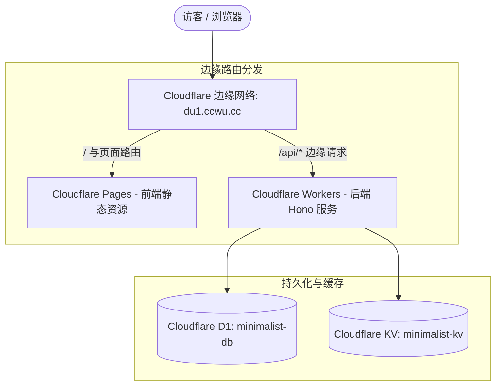

# Cloudflare 生产环境部署与域名绑定实操指南

本文档记录将 `minimalist-web` 全栈项目部署至 Cloudflare，并通过自定义域名 `du1.ccwu.cc` 访问的完整操作流程。

---

## 一、架构拓扑与统一域名路由

整个全栈工程在 Cloudflare 边缘网络上共享统一域名 `du1.ccwu.cc`，无需配置跨域（CORS）：



- **前端层 (Pages)**：托管 Vue 3 + Vite 构建产物，通过 `frontend/public/_redirects` 解决 SPA 页面刷新 404 问题。
- **后端层 (Workers)**：运行 Bun + Hono 编译产物，边缘路由规则 `du1.ccwu.cc/api/*` 拦截所有接口请求。
- **数据层 (D1 / KV)**：D1 负责用户与业务数据持久化，KV 负责高频会话与轻量缓存。

---

## 二、当前账号与云端基础设施资源清单

在当前 Cloudflare 账号（`wq1040822172@gmail.com`）下，已关联以下云端资源：

| 资源类别 | 资源名称 / 标识 | 资源 ID / 绑定位点 | 状态 |
| :--- | :--- | :--- | :--- |
| **Account** | Wq1040822172@gmail.com's Account | `cb5bb69457d6d8626ed814e86493e500` | 正常 |
| **Zone (域名)** | `du1.ccwu.cc` | `be156ae8055b5cd4dfc2ca9c9aea3074` | Active |
| **D1 Database** | `minimalist-db` | `11abe273-d6af-45ae-8da1-cad2960e990c` | 已创建（待建表） |
| **KV Namespace** | `minimalist-web-backend-minimalist-kv` | `42c4b04dda864c919907a66f4ac1a296` | 正常 |
| **Workers Script**| `minimalist-web-backend` | 路由: `du1.ccwu.cc/api/*` | 待部署 |
| **Pages Project** | `minimalist-web-frontend` | 自定义域名: `du1.ccwu.cc` | 待部署 |

---

## 三、部署执行步骤

### 步骤一：初始化 D1 远程数据库表

在 `backend` 目录下执行 SQL 脚本，在远程 D1 数据库中创建数据表：

```bash
cd backend
npx wrangler d1 execute minimalist-db --remote --file=./src/db/init.sql
```

> [!NOTE]
> 执行完成后，数据库中将生成用户与相关业务表，可运行 `npx wrangler d1 execute minimalist-db --remote --command="SELECT * FROM users"` 验证。

---

### 步骤二：部署后端 Workers API

在 `backend` 目录下执行发布命令：

```bash
cd backend
npx wrangler deploy
```

发布成功后输出示例：
```text
Total Upload: ... KiB / gzip: ... KiB
Uploaded minimalist-web-backend (...)
Published minimalist-web-backend (...)
  Routes:
    - du1.ccwu.cc/api/*
```

此时 `du1.ccwu.cc/api/*` 的流量已被 Cloudflare Workers 边缘拦截处理。

---

### 步骤三：构建并部署前端至 Cloudflare Pages

1. **安装依赖并执行前端构建**：

```bash
cd frontend
pnpm install
pnpm run build
```

构建成功后将生成 `frontend/dist` 静态资源目录（包含 `_redirects` 文件）。

2. **通过 Wrangler 直接发布前端产物**：

```bash
npx wrangler pages deploy dist --project-name minimalist-web-frontend
```

初次部署时若提示创建项目，按提示确认即可。部署完成后将获得一个临时测试域名（如 `minimalist-web-frontend.pages.dev`）。

---

### 步骤四：在 Pages 中绑定自定义域名 `du1.ccwu.cc`

1. 登录 [Cloudflare 控制台](https://dash.cloudflare.com/)。
2. 左侧导航进入 **Workers & Pages** -> 点击进入 **minimalist-web-frontend** 项目。
3. 切换至 **Custom domains**（自定义域）选项卡。
4. 点击 **Set up a custom domain**。
5. 在输入框中填写：`du1.ccwu.cc`，点击 **Continue**。
6. 系统会自动识别当前账号内托管的 `du1.ccwu.cc` Zone 并完成 DNS 记录更新，点击 **Activate domain** 确认激活。

---

## 四、部署后线上自检与验证

部署与域名生效后，执行以下验证确保链路畅通：

1. **验证前端页面**：
   在浏览器直接访问：`https://du1.ccwu.cc/`
   - 检查页面是否正常加载并展示问候语。
   - 检查控制台网络请求，确认静态 JS/CSS 资源状态码为 `200`。
2. **验证后端接口**：
   在终端或浏览器中访问：
   ```bash
   curl -i https://du1.ccwu.cc/api/user
   ```
   预期响应格式：
   ```json
   {
     "code": 200,
     "data": {
       "name": "..."
     },
     "message": "success"
   }
   ```
3. **验证 SPA 刷新回退**：
   直接访问深层页面路径（如 `https://du1.ccwu.cc/about`），确认不会返回 404，由 `_redirects` 正确重定向至 `index.html`。

---

## 五、关键配置文件与避坑说明

1. **`backend/wrangler.toml` 中的 Zone 对应**：
   在 Cloudflare 中，`du1.ccwu.cc` 为独立 Zone。`routes` 配置必须填写 `zone_name = "du1.ccwu.cc"`，切勿写为父级根域。
2. **SPA 重定向规则 (`frontend/public/_redirects`)**：
   文件内容必须包含：
   ```text
   /*    /index.html   200
   ```
   以保证 Vite 单页应用在任意前端路径刷新时正常工作。
3. **敏感凭据与环境变量管理**：
   若需接入 JWT 密钥或第三方 API Key，请使用 `wrangler secret put <KEY_NAME>` 配置在云端，严禁写入前端代码或提交到代码仓库。

---

## 六、全自动持续集成与部署 (GitHub Actions)

项目已配置 GitHub Actions 自动部署流水线，实现代码推送到 `main` 分支后自动构建并更新至 Cloudflare。

### 1. 工作流文件结构
- 前端工作流：`.github/workflows/deploy-frontend.yml`（仅当 `frontend/**` 变更时触发）
- 后端工作流：`.github/workflows/deploy-backend.yml`（仅当 `backend/**` 变更时触发）

### 2. GitHub 仓库 Secret 环境变量配置
前往 GitHub 仓库 -> **Settings** -> **Secrets and variables** -> **Actions**，点击 **New repository secret** 添加以下两项：

| Secret 变量名 | 获取来源 / 说明 | 示例值 |
| :--- | :--- | :--- |
| **`CLOUDFLARE_API_TOKEN`** | Cloudflare 控制台 -> **My Profile** -> **API Tokens** 创建（包含下述前端与后端完整权限） | `...` |
| **`CLOUDFLARE_ACCOUNT_ID`**| Cloudflare 账户 ID | `cb5bb69457d6d8626ed814e86493e500` |

---

### 3. Cloudflare API 令牌 (`CLOUDFLARE_API_TOKEN`) 必需权限清单

前往 [Cloudflare 控制台 - API 令牌](https://dash.cloudflare.com/profile/api-tokens)，创建自定义令牌（或编辑已有令牌），必须包含以下**全部权限**，否则 GitHub Actions 自动化部署将报错：

#### (1) 账户权限 (Account Policies)
> **资源范围**：`包含所有账户`（或选择对应的主账户）

| 权限分类 (Category) | 权限项 (Permission) | 访问级别 (Access) | 作用说明 |
| :--- | :--- | :--- | :--- |
| **账户 (Account)** | **Cloudflare Pages** | **编辑 (Edit)** | **前端必需**：用于 `wrangler pages deploy` 构建产物上传与版本发布 |
| **账户 (Account)** | **Workers 脚本 (Workers Scripts)** | **编辑 (Edit)** | **后端必需**：用于 `wrangler deploy` 发布与更新后端 Workers 脚本 |
| **账户 (Account)** | **D1** | **编辑 (Edit)** | **后端必需**：用于远程 D1 数据库执行初始化脚本与 SQL 迁移 (`wrangler d1 execute`) |
| **账户 (Account)** | **Workers KV 存储 (Workers KV Storage)** | **编辑 (Edit)** | **后端必需**：用于创建、绑定与操作 KV 缓存命名空间 |

#### (2) 区域权限 (Zone Policies)
> **资源范围**：`包含所有区域`（或选择绑定的域名 `du1.ccwu.cc`）

| 权限分类 (Category) | 权限项 (Permission) | 访问级别 (Access) | 作用说明 |
| :--- | :--- | :--- | :--- |
| **区域 (Zone)** | **Workers 路由 (Workers Routes)** | **编辑 (Edit)** | **路由必需**：用于自动将边缘路由规则（如 `du1.ccwu.cc/api/*`）绑定到对应域名 |
| **区域 (Zone)** | **区域 (Zone)** | **读取 (Read)** | **检查必需**：用于 Wrangler 校验域名托管状态与检索 Zone 标识 |

#### (3) 用户权限 (User Policies - 可选/默认)
- **User Details**: `读取 (Read)`
- **Memberships**: `读取 (Read)`

---

配置完成后，后续任何针对前端或后端的改动，执行 `git push origin main` 即可全自动触发线上发布。
