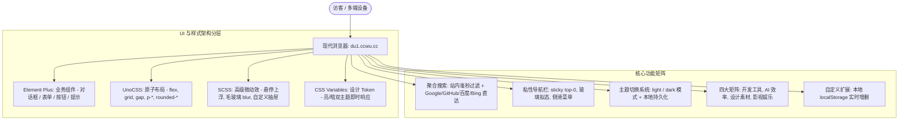

# Jie Hub - 云端聚合导航说明文档

## 一、 项目定位与升级背景

在多设备办公与跨平台开发中，高频工具和优质资源往往散落各地。**Jie Hub**（原 minimalist-web / CKJ Hub 演进）是构建在 Cloudflare 全球边缘网络之上的云端聚合导航中枢。

**核心目标**：
- **换电脑即开即用**：依托 Cloudflare Anycast 全球网络与统一域名（`du1.ccwu.cc`），随时随地打开即是熟悉且完备的工作台。
- **现代化技术栈分层**：
  - **Element Plus**：承载弹窗、表单、下拉、开关、提示等高品质交互业务组件。
  - **UnoCSS**：原子化实用类，实现快速响应式切块、间距、排版与 Flex/Grid 布局。
  - **SCSS**：承载复杂动画过渡、拟物与毛玻璃视觉效果、微交互。
  - **CSS Variables**：全量设计 Token（Design Tokens），支撑浅色/深色主题无缝切换。
- **视觉品牌化**：由 `/logo-generator` 基于关键词 "jie"（捷/杰/界）构思专属矢量 Logo，打造具备高辨识度的极客导航。

---

## 二、 技术架构与现代化样式栈



### 1. UnoCSS 配置规范
在 [`frontend/uno.config.js`](file:///d:/demo/web/cloudflare/minimalist-web/frontend/uno.config.js) 中配置：
- `presetUno({ dark: 'class' })`：与 Element Plus 暗色模式完全接轨。
- `presetAttributify()`：支持属性化与简洁类名。
- `presetIcons()`：现代化图标支持。

### 2. 设计 Token 与主题切换机制
在 [`frontend/src/assets/styles/global.scss`](file:///d:/demo/web/cloudflare/minimalist-web/frontend/src/assets/styles/global.scss) 中定义 `:root` 与 `html.dark`：
- 背景色彩 Token：`--bg-page`, `--bg-surface`, `--bg-surface-soft`, `--bg-card`
- 边框与阴影 Token：`--border-color`, `--card-shadow`, `--card-shadow-hover`
- 文字排版 Token：`--text-primary`, `--text-regular`, `--text-muted`
- 主色 Token：`--primary-color`, `--primary-light`, `--primary-hover`

通过 [`frontend/src/composables/useTheme.js`](file:///d:/demo/web/cloudflare/minimalist-web/frontend/src/composables/useTheme.js) 管理 `isDark` 状态，自动同步 `html.dark` 类并持久化至 `localStorage`。

---

## 三、 品牌 Logo 设计 (`/logo-generator`)

围绕关键词 **"jie"**（捷/杰/界）与 **"Hub"**（枢纽/连接），通过专业矢量生成流程打造：

- **主选方案 (Hub Orbital J)**：已置于 [`frontend/public/logo.svg`](file:///d:/demo/web/cloudflare/minimalist-web/frontend/public/logo.svg)。开环星轨代表开放生态，核心 'J' 字干轴沉稳流畅，右上角以亮核作为能量聚合点。
- **创意矩阵展厅**：可打开 [`docs/jie-logo-showcase.html`](file:///d:/demo/web/cloudflare/minimalist-web/docs/jie-logo-showcase.html) 预览 6 种不同构型（星轨互联、单线莫比乌斯环、圆角负空间雕刻、拓扑节点网络、赛博六边形、极速光弧）。

---

## 四、 核心组件与布局说明

| 组件路径 | 职责定位 | 样式与技术要点 |
| :--- | :--- | :--- |
| [`NavBar.vue`](file:///d:/demo/web/cloudflare/minimalist-web/frontend/src/layout/NavBar.vue) | **顶部粘性导航栏** | `sticky top-0 z-100`，毛玻璃背景，集成 Element Plus 主题切换与移动端侧滑抽屉 |
| [`SearchBar.vue`](file:///d:/demo/web/cloudflare/minimalist-web/frontend/src/components/SearchBar.vue) | **多引擎聚合搜索** | 集成 Element Plus `el-input` + `el-button`，支持站内实时过滤与外部分流 |
| [`CategoryAnchor.vue`](file:///d:/demo/web/cloudflare/minimalist-web/frontend/src/components/CategoryAnchor.vue) | **分类定位锚点栏** | `sticky top-60px z-50`，平滑锚点滚动，集成“添加网址”入口 |
| [`NavCard.vue`](file:///d:/demo/web/cloudflare/minimalist-web/frontend/src/components/NavCard.vue) | **导航卡片** | Favicon 自动解析 + 首字母彩绘徽标兜底 + `el-tooltip` 复制直达 |
| [`AddBookmarkModal.vue`](file:///d:/demo/web/cloudflare/minimalist-web/frontend/src/components/AddBookmarkModal.vue) | **添加网址对话框** | 基于 Element Plus `el-dialog` + `el-form` 表单校验体系 |
| [`TheFooter.vue`](file:///d:/demo/web/cloudflare/minimalist-web/frontend/src/layout/TheFooter.vue) | **全局页脚** | 版权信息与 Cloudflare 部署声明 |

---

## 五、 本地运行与生产构建

```bash
# 1. 切换至前端工程目录
cd frontend

# 2. 启动本地开发服务 (支持 HMR 热更新)
pnpm run dev

# 3. 生产环境构建校验
pnpm run build
```
构建成功后将生成 `frontend/dist` 产物，由 GitHub Actions 流水线自动推送发布至 Cloudflare Pages。
